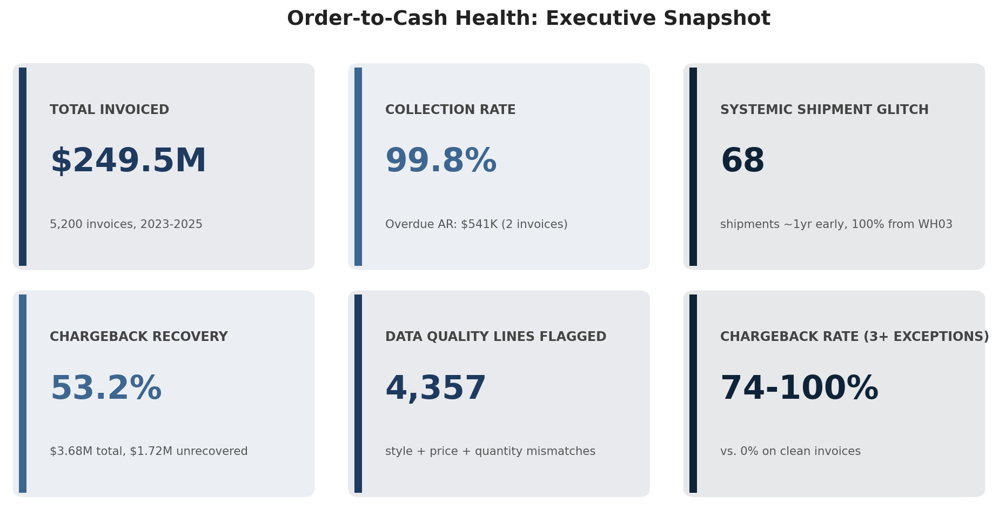
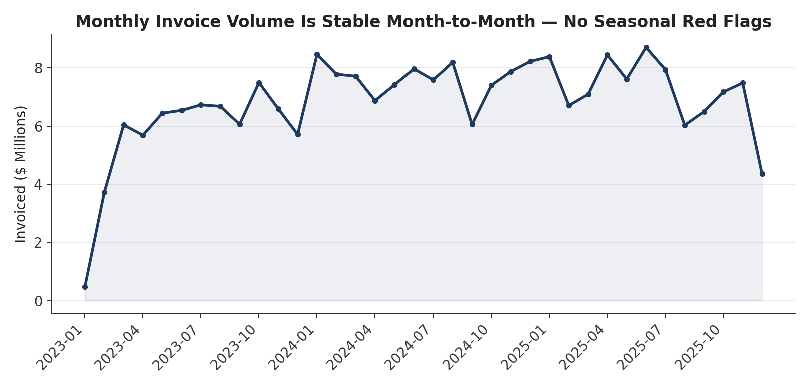
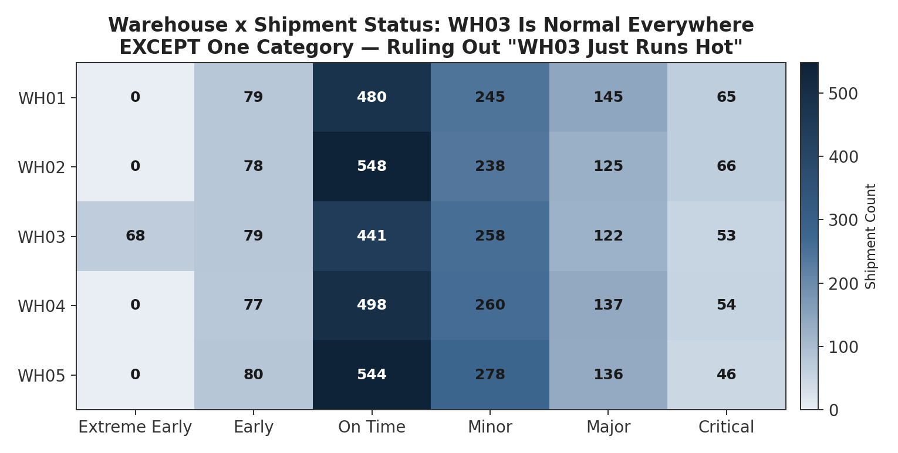
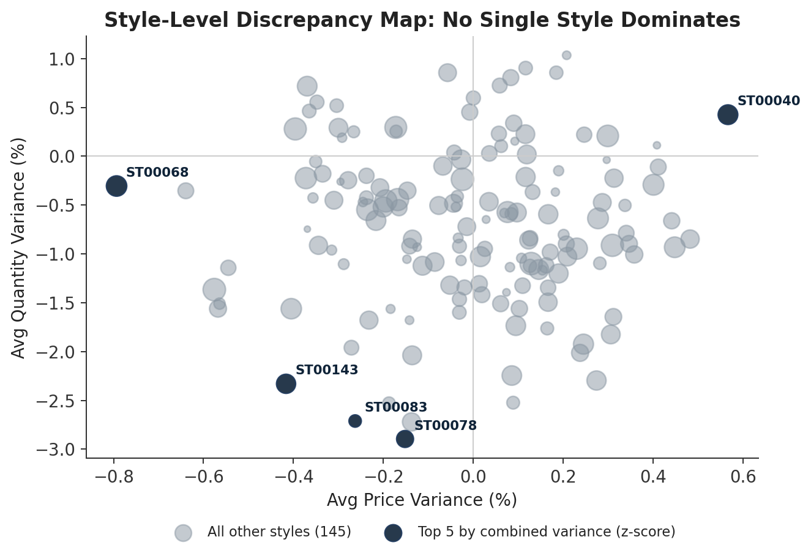
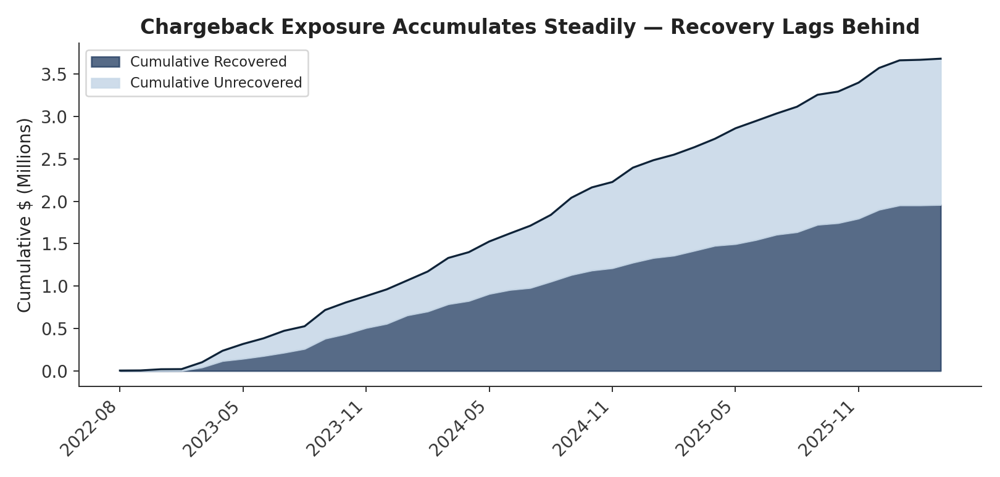
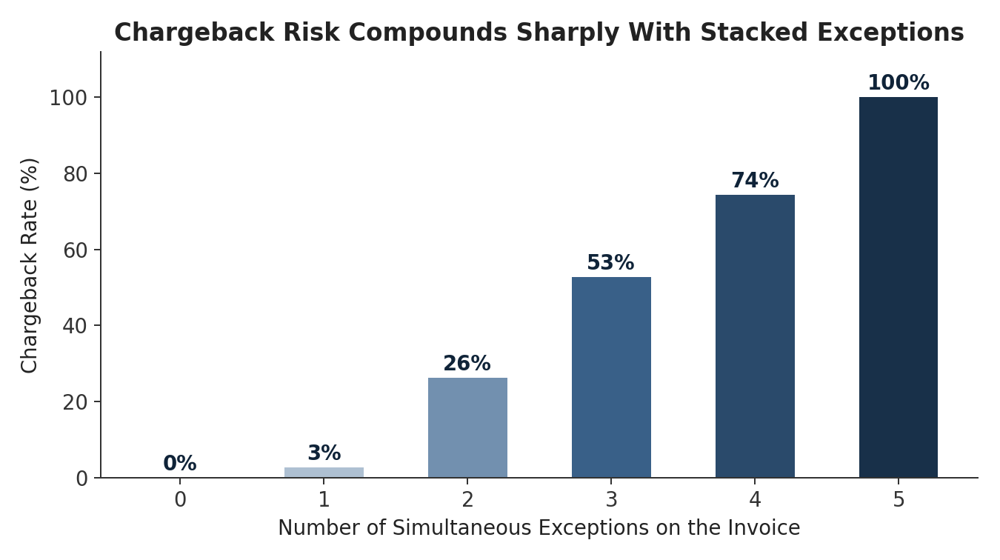

# Order-to-Cash Exception Analysis: Finding the Real Reasons AR Goes Overdue

**SQL · Python (pandas/matplotlib) · Power BI · Statistical Testing**

## The Problem

A fashion supplier processes thousands of purchase orders, shipments, and invoices a year. Finance
knew AR was a persistent headache but couldn't say *why* — was it slow-paying customers, or
something breaking earlier in the Purchase Order → Warehouse → Shipment → Invoice → Payment chain?
I built a synthetic 5,200-order dataset modeling exactly this scenario and worked it the way I'd
approach a live investigation: validate the data first, quantify what's broken, then test whether
it actually explains the financial outcome — rather than assuming it does.

## Starting Point: Is There Anything Obviously Wrong?

Before hunting for problems, I checked the basics — is invoice volume stable, or is there a
seasonal spike or cliff hiding the real story?

Nothing unusual here. Volume holds steady in the $6–8.5M/month range for three years. That's
useful — it means whatever AR problem exists isn't a volume or seasonality artifact, which clears
the way to look at data quality and operations instead.

## Finding #1: A Systemic Bug, Not Random Error

Looking at shipment timing across all 5,200 orders, 68 shipments went out **roughly a year ahead of
schedule**. The critical question: is that scattered noise, or something structural? I cross-tabbed
every warehouse against every shipment-timing category to find out:

Read across any row and the story is obvious: WH03's counts for On Time, Minor, Major, and Critical
are all within a few percent of the other four warehouses — it's an entirely ordinary warehouse in
every category **except one**. All 68 extreme-early shipments sit in that single cell. That rules
out "WH03 just handles riskier orders" and points squarely at a location-specific system bug.

## Finding #2: No Single "Bad Style" — the Problem Is Diffuse

A natural next question once you find pricing and quantity variance: is one SKU driving it?

No. The five most extreme styles by combined variance aren't dramatically separated from the other
145 — this is noise spread evenly across the catalog, not a single mispriced product. That's a
real, useful negative result: it redirects the fix from "audit this SKU" to "fix the invoicing
process itself."

## Finding #3: Chargebacks Are a Growing, Under-Recovered Liability

Chargeback exposure has grown steadily for three years, and the recovered portion (solid navy)
hasn't kept pace with total exposure (the pale gap above it) — by the end of the window, roughly
**47% of all chargeback dollars are still unrecovered.**

## Finding #4: What Actually Drives Those Chargebacks

I tested whether shipment timing, quantity accuracy, or price accuracy best predicted a chargeback.
Shipment timing barely moved the needle — but stacking quantity and price exceptions on the same
invoice compounds risk dramatically:

An invoice with three or more simultaneous exceptions is virtually guaranteed a chargeback. I
closed the loop with a Mann-Whitney U test on payment timing specifically: exceptions did **not**
significantly predict slower *payment* (p = 0.91, an honest null result) — but tracing the
company's entire $541K in overdue AR led to exactly two invoices, and both carried all three
data-quality exceptions. Timing wasn't the predictor; being a flagged invoice was.

## Recommendations (tied directly to findings, not generic advice)

1. **Pre-invoice validation** on quantity and price against the PO — the two exceptions actually
   driving chargebacks (Finding #4).
2. **A targeted system audit at WH03 specifically** — not a network-wide policy change, since the
   heatmap rules out a systemic, company-wide timing problem (Finding #1).
3. **AR collections weighted by exception flags, not just invoice age** — the two invoices worth
   chasing were identifiable the moment they were billed (Finding #4).

## Tools & Skills Demonstrated

SQL (multi-table joins, CASE-based classification, aggregation) · Python (pandas for validation and
re-derivation, matplotlib for a full range of visualization types, scipy for hypothesis testing) ·
Power BI (star-schema modeling, DAX measures) · Root-cause methodology · Careful
association-vs-causation language throughout

**Full project:** [SQL scripts](sql/) · [Jupyter notebook](notebooks/) · [Power BI build guide](docs/02_power_bi_build_guide.md)
